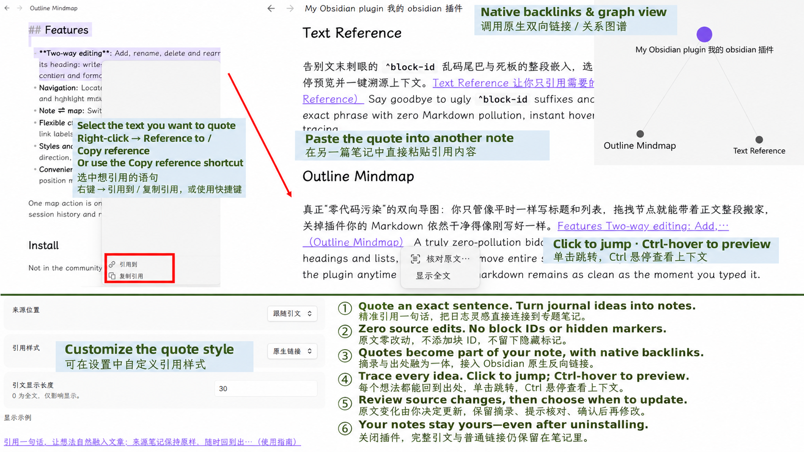
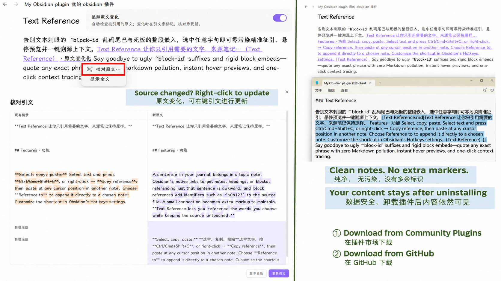

# Text Reference

## Scenario · 场景

A sentence in your journal belongs in a topic note. Obsidian's native links target notes, headings, or blocks; referencing just that sentence is awkward, and block references add identifiers such as `^abc123` to the source file. A small connection becomes extra markup to maintain. **Text Reference lets you reference the words you choose while keeping the source untouched.**

日志里的一句话，值得放进专题笔记。Obsidian 原生链接面向笔记、标题或块，难以直接引用段落中的某句话；块引用还会在源文件留下 `^abc123` 这样的标识符。原本只想关联一个想法，却多了一串需要维护的标记。**Text Reference 让你只引用需要的文字，来源笔记保持原样。**

## Features · 功能

### Quick start · 快速上手

1. **Select text** in a source note. / 在来源笔记中**选中要引用的文字**。
2. **Copy reference** with **Ctrl/Cmd+Shift+C**, or right-click → **Copy reference**. / 按 **Ctrl/Cmd+Shift+C**，或右键选择「**复制引用**」。
3. **Paste** at any cursor position in another note. To append directly to a chosen note, use **Reference to** instead. / 在另一篇笔记的光标处**粘贴**；也可右键选择「**引用到**」，直接追加到指定笔记。
4. **Click** the quote to return to its source; **Ctrl/Cmd+hover** to preview context. / **单击引文**跳转原文；按住 **Ctrl（Mac 用 Cmd）并悬停**查看上下文。

### Display & navigation · 显示与跳转

Quote and source appear together as an inline link, with native file-level backlinks and graph connections. Click to return to the source, or drag to select the quote text. Context previews highlight the quoted range when it can be reliably matched.

引文与来源合为一个行内链接，支持 Obsidian 原生文件级反向链接与关系图谱。单击回到出处，也可拖动选择引文文字。预览会在能可靠匹配时标记所引用的范围。

Adjust the displayed length, source position, and quote style in the plugin settings; changes apply to existing references. The default displays 30 characters. Right-click a quote to expand or collapse its full text. Customize **Copy reference** in Obsidian's **Hotkeys** settings.

在插件设置中调整显示长度、来源位置和引用样式，设置会应用于已有引用；默认显示 30 字。右键引文可显示或收起全文。「复制引用」快捷键可在 Obsidian 的「快捷键」设置中自定义。

### Review source changes · 核对原文变化

Source-change tracking is on by default. When the source changes, the plugin keeps your excerpt and flags it for review. Right-click the quote → **Review source…**, compare the existing excerpt with the new source, then confirm to update that reference. If the source range cannot be reliably located, the excerpt is preserved.

默认开启原文变化追踪。原文变化后，插件保留已有摘录并提示核对。右键引文 →「**核对原文…**」，对比现有摘录与新原文，确认后再更新该条引文。无法可靠定位原文范围时，保留摘录。

## Highlights · 特色

- **Quote an exact sentence.** Connect an idea from your journal directly to a topic note.

  **引用，精确到一句话。** 把日志里的灵感，直接连接到专题笔记。

- **Leave the source untouched.** No added block IDs or hidden markers in the source note.

  **原文零改动。** 不在来源笔记中添加块 ID 或隐藏标记，让原文保持干净。

- **Make quotes part of your writing.** Excerpt and source form one inline link, connected to Obsidian's native file-level backlinks.

  **引文就是正文的一部分。** 摘录与出处融为一体，接入 Obsidian 原生文件级反向链接。

- **Trace every idea to its source.** Click to jump back; Ctrl/Cmd+hover to preview the context.

  **每个想法，都能回到出处。** 单击跳转原文，按住 Ctrl（Mac 用 Cmd）并悬停查看上下文。

- **Choose when to update.** Keep the excerpt, review source changes, and confirm before updating.

  **原文变化，你来决定更新。** 保留摘录，提示核对，确认后再修改引文。

- **Your content stays yours.** Disable or uninstall the plugin: the full excerpt and ordinary link remain in your note.

  **关闭插件，内容依然属于你。** 完整引文与普通链接仍保留在笔记里，卸载插件后也能阅读。

## Installation & data · 安装与数据

Requires **Obsidian 1.8.7+**. Put `main.js`, `manifest.json`, and `styles.css` in `.obsidian/plugins/text-reference/`, then enable the plugin. The interface follows Obsidian's language, in English or Chinese.

需要 **Obsidian 1.8.7 或以上版本**。将 `main.js`、`manifest.json`、`styles.css` 放入 `.obsidian/plugins/text-reference/`，然后启用插件。界面跟随 Obsidian 语言，支持中英文。

Keep `data.json` when upgrading and sync it across devices to preserve precise reference associations. The plugin adds no network requests or telemetry; reference data stays in your vault.

升级时保留 `data.json`；跨设备使用请同步它，以保留精确引用关联。插件不额外发送网络请求，不采集遥测，引用数据保存在笔记库内。

## Updates · 更新

**0.12.0** — Improved context-preview range highlighting, refreshed navigation after updates, and reduced duplicate reads and listeners. **101 automated checks pass**; real Obsidian, mobile, and third-party theme validation remains outstanding. See [Changelog](CHANGELOG.md) for details. For development: `npm ci`, then `npm run check`.

**0.12.0** — 改进上下文预览的范围标记与更新后的跳转，减少重复读取和事件监听。**101 项自动检查通过**；真实 Obsidian、移动端和第三方主题仍待实机验证。详情见[更新记录](CHANGELOG.md)。开发验证：先运行 `npm ci`，再运行 `npm run check`。
